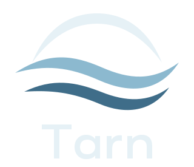
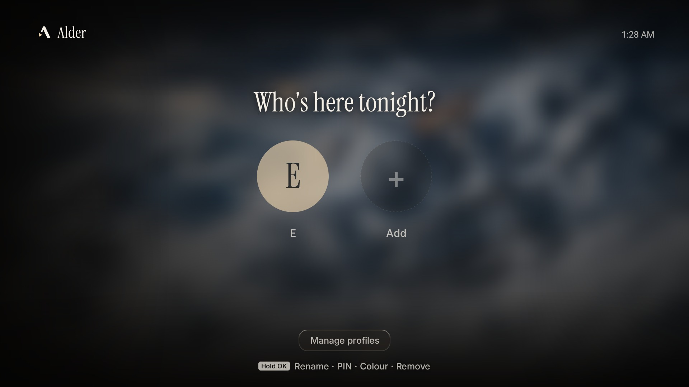
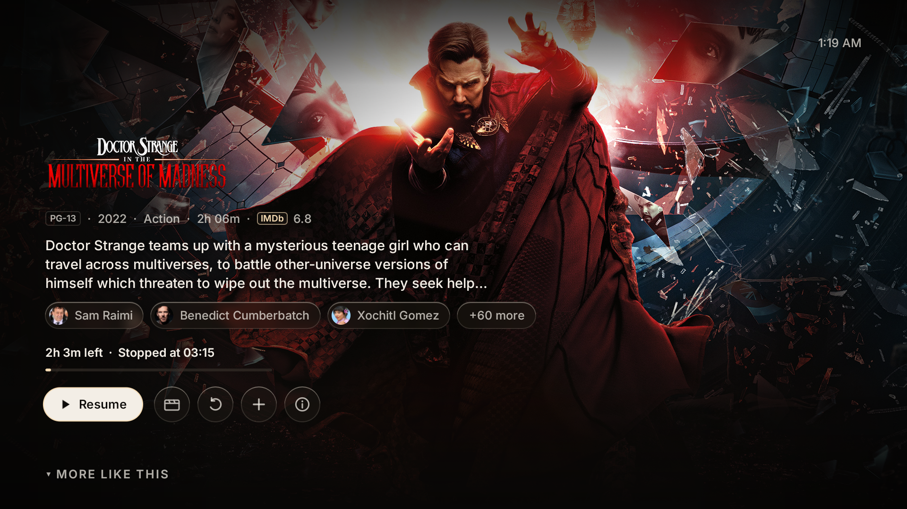
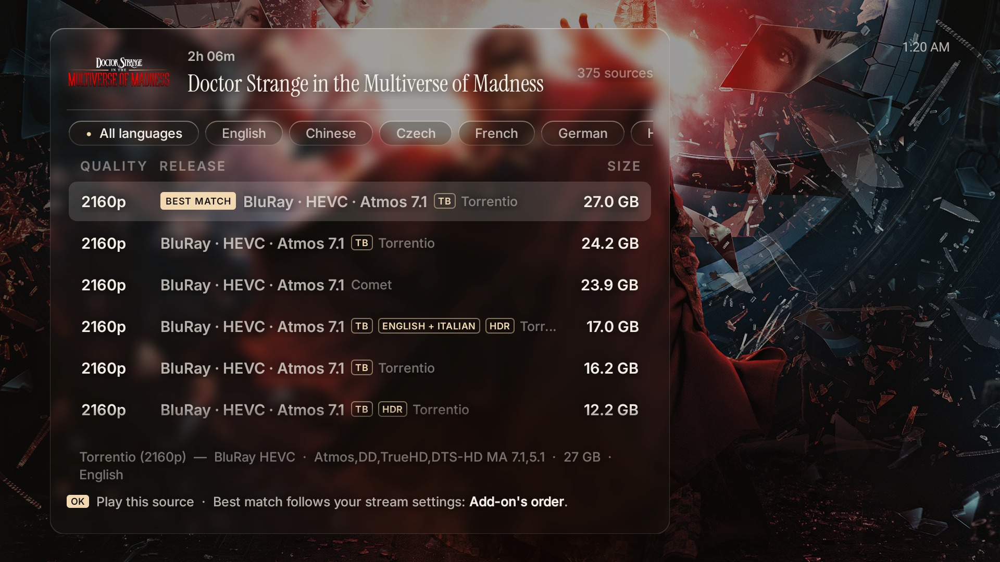
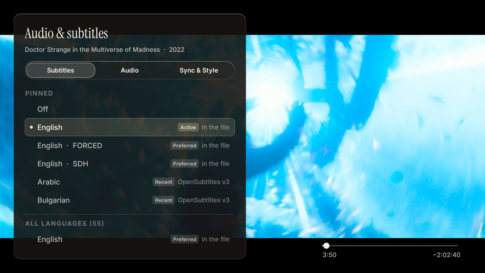
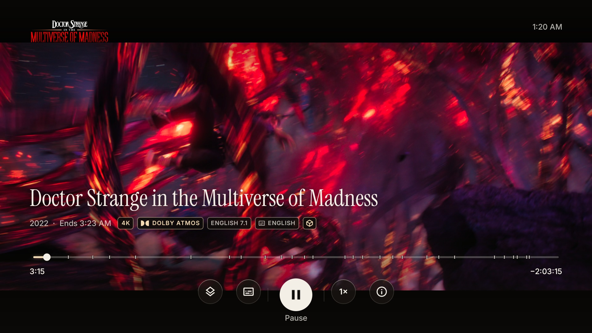
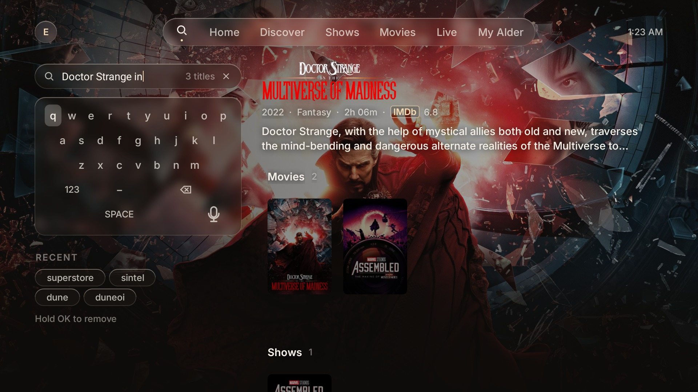
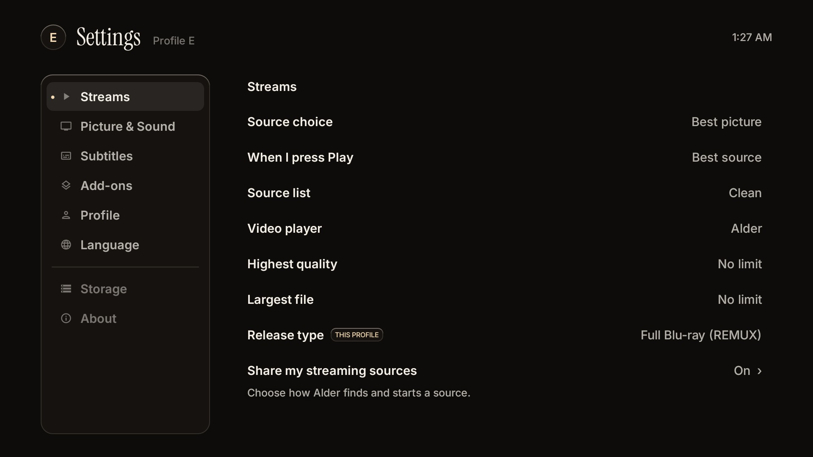
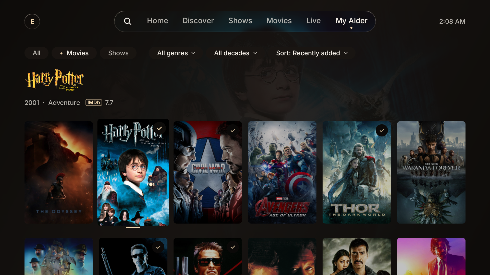

<h1 align="center">Tarn</h1>

<p align="center">
  <b>Stremio for the living room.</b><br>
  Press Play and it plays. No stream lists to decode, no dead links, no setup on the remote.
</p>

<p align="center">
  <a href="https://alexx2k.github.io/Tarn/"></a>
  <a href="https://github.com/alexx2k/Tarn/releases/latest"></a>
  <a href="https://github.com/alexx2k/Tarn/releases"></a>
  
  <a href="LICENSE"></a>
</p>

<p align="center">
  
</p>

Tarn is an Android TV app for your Stremio account. Your account, add-ons, library and watch progress stay exactly where they are, and everything you watch syncs back to Stremio on your phone and computer. What changes is the app on the TV: built for a remote, simple enough for anyone in the family, and quiet enough that the film is the main thing on screen.

## Why Tarn

Stremio on a TV hands you a list of fifty streams named like `2160p.WEB.HEVC.DV.HDR10.Atmos`, and leaves you to guess which one your TV can play. That's fine for the person who set it up. It isn't for parents, grandparents, or anyone who just wants to watch.

Tarn makes that choice for them:

- **Press Play, it plays.** Tarn picks the best source for your TV and starts it. Hold OK when you want to choose yourself.
- **Keep your favourite provider.** Pick a source for a series and Tarn tries the same add-on first on later episodes. If it is unavailable, Tarn selects another.
- **Dead links don't stop the film.** If a stream fails or shows no picture within 12 seconds, Tarn moves to the next one from the same second. You only see the list if three fail in a row.
- **It knows your TV.** Files your TV can't decode are left out before anyone sees them, including Dolby Vision profiles it can't show and 4K on a 1080p screen.
- **Automatic audio output.** Tarn sends TrueHD and DTS-HD to audio devices that support those formats. If passthrough fails, Tarn tries to decode the same track to PCM at the same position before it changes tracks or sources.
- **Everyone gets their own profile.** Up to 5, with separate watch history, local profiles that can share one Stremio account, and optional PINs.

## A look around

<table>
  <tr>
    <td width="50%"><br><b>Who's here tonight?</b> One profile per person, each its own Stremio account.</td>
    <td width="50%"><br><b>Title page.</b> Full-screen art, details and one clear button to Play or Resume.</td>
  </tr>
  <tr>
    <td><br><b>Sources, when you want them.</b> Hold OK to see every source in plain columns: quality, release, size. Best match is marked.</td>
    <td><br><b>Audio and subtitles in one panel.</b> Choose a track or adjust subtitle timing and style.</td>
  </tr>
  <tr>
    <td><br><b>A calm player.</b> Time left, when it ends, and the few controls that matter.</td>
    <td><br><b>Search across every add-on</b>, with a keyboard built for the remote, and voice.</td>
  </tr>
  <tr>
    <td><br><b>Preferences in plain words.</b> Best picture, Balanced or Fast start; no release jargon needed.</td>
    <td><br><b>My Tarn.</b> Find saved films and shows, filter by genre or decade, and pick up where you left off.</td>
  </tr>
</table>

Tarn can also show Continue Watching on the Google TV home screen, skip intros when timings are available, move to the next episode and match the TV's frame rate to the video. If a stream keeps buffering, it can offer a lower-quality source at the same playback position.

## Tarn vs. Stremio on the TV

| | Tarn | Stremio for Android TV |
|---|---|---|
| Your Stremio account, add-ons and library | ✅ | ✅ |
| Watch progress synced with your phone and computer | ✅ | ✅ |
| Pressing Play | **Starts the best source for your TV** | Opens a list of streams to choose from |
| When a stream fails | **Tries the next one from the same second** | Back to the list |
| Files the TV can't decode | **Hidden before you see them** | Listed; you find out when it won't play |
| Profiles | **Up to 5, with shared-account local profiles and PINs** | One account per install |
| Stream preferences | **Plain words: Best picture, Balanced, Fast start** | Set inside each add-on |
| Skip intro | ✅ | ❌ |
| Continue Watching on the Google TV home | ✅ | ❌ |
| Finding and configuring add-ons | In Stremio on your phone or computer, synced to the TV | On the TV, or on your phone or computer, synced to the TV |
| Torrent streaming | ✅ P2P sources on Android 7 or newer, after debrid ones | ✅ |
| App size | **About 24 MB** (5 MB without the P2P engine) | Much larger, with a streaming server |
| Built for | **A TV and a remote** | Shared with desktop and web |

## How it fits with Stremio

You keep using Stremio. Tarn is the part you sit in front of.

- **On your phone or computer, in Stremio:** create your account, find add-ons, configure them (AIOStreams, Torrentio with a debrid service and the like are set up on a web page) and install them.
- **On your TV, in Tarn:** sign in once with a code, then browse, play and pick up where you left off. Add-ons you install in Stremio show up in Tarn on their own.

Tarn has no add-on store. Setting up add-ons means typing and web forms, which is easier on a phone than with a remote.

On Android 7 or newer, sources marked **P2P** play torrents from your add-ons. Tarn tries them after debrid and direct sources. P2P playback connects your TV to torrent peers, which can see its public IP address.

## Requirements

- Android TV, Google TV, or Fire TV running **Android 6.0 (Marshmallow, Fire OS 6) or newer**
- A Stremio account with stream add-ons, set up in Stremio on your phone or computer
- A way to sideload an APK: the *Downloader* app, a USB drive with a file manager, or `adb`

## Install

1. On your phone or computer, sign in to [Stremio](https://web.stremio.com) and install your add-ons.
1. Download `Tarn-2.0.0.apk` from the [latest release](https://github.com/alexx2k/Tarn/releases/latest).
1. Install it on your TV. Use the Downloader app with the APK URL, a USB drive with a file manager, or `adb install Tarn-2.0.0.apk`.
1. Open **Tarn**, name your profile and sign in to Stremio with the code on screen. Your add-ons, library and Continue Watching come with it.

After that, Tarn offers new versions itself: press Install when it asks, or use Settings › About › Updates. Android may ask you to allow Tarn to install apps the first time.

## Privacy

Tarn has no analytics, no ads and no account of its own. Local crash logs stay on the device; remote crash submissions are disabled until a Tarn-owned endpoint is configured. It talks to Stremio, to the add-ons you installed, to image hosts for artwork, to [IntroDB](https://introdb.app) for intro times, and to GitHub to check for updates. Profiles and their PINs stay on the TV.

## Building from source

```sh
git clone https://github.com/alexx2k/Tarn.git
cd Tarn
./gradlew assembleRelease
```

The standard APK is written to `app/build/outputs/apk/release/`. Run `packageTarnRelease` with your production signing configuration for the named APK in `app/build/outputs/tarn/`. A `-PdebugKey` build is CI-only and must never be published as a production update.

## Credits

Tarn is a fork of [Alder](https://github.com/aradhyas8/Alder), previously developed here as Alder Fork. Tarn borrows from open-source projects:

- [NuvioTV](https://github.com/tapframe/NuvioTV) (GPL-3.0): player setup, profiles, Watch Next, skip intro
- [Just Player](https://github.com/moneytoo/Player) (Unlicense): frame-rate matching, audio passthrough, subtitle styling
- [stremio-core](https://github.com/Stremio/stremio-core) (MIT): library format, sync and Continue Watching rules
- [AndroidX Media](https://github.com/androidx/media) (Apache-2.0): ExoPlayer

Tarn is not affiliated with Stremio.

## License

Copyright (C) 2026 aradhyas8

Tarn is free software, released under the [GNU General Public License v3.0](LICENSE).

P2P playback uses [Nuvio Engine v0.1.6 source](https://github.com/NuvioMedia/nuvio-engine/tree/v0.1.6) under GPL-3.0-or-later. The APK includes the [engine and dependency licenses](app/src/main/assets/licenses/nuvio-engine).
